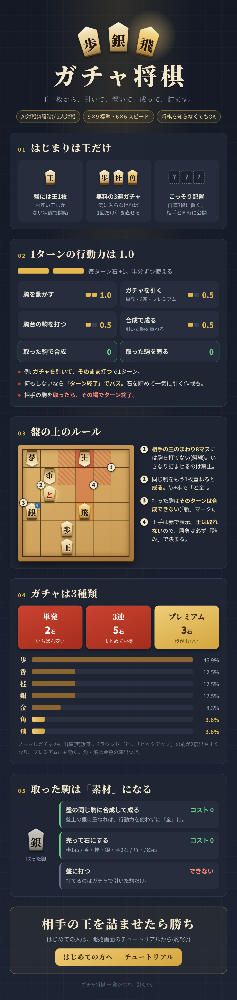

# ガチャ将棋

**王一枚から、引いて、置いて、成って、詰ます。**

将棋のルールをもとに、盤上の駒そのものをガチャで引き当てて戦うブラウザゲームです。
対局はお互い「王」1枚だけで始まります。毎ターン手に入る石でガチャを引き、引いた駒を盤に打ち、同じ駒を重ねて成らせながら、相手の王を詰ませれば勝ちです。

AI対戦(4段階)と、1台の端末を交代で使う2人対戦に対応しています。将棋を知らない人のために、約5分のチュートリアルも入っています。

<p align="center"></p>

---

## 特徴

- **ガチャで戦力を集める将棋**: 単発(2石)・3連(5石)・歩が出ないプレミアム(3石)の3種類。3ラウンドごとに出やすくなる駒(ピックアップ)が変わります
- **行動力 1.0 の手番制**: 駒を動かす(1.0)か、ガチャ・打つ・合成(各0.5)を組み合わせるかを、毎ターン選びます
- **取った駒は「素材」になる**: 同じ駒に重ねれば行動力を使わずに成れ、売れば石になります(盤に打つことはできません)
- **AIは4段階**: よわい / ふつう / つよい / 達人(相手の応手まで読みます)
- **相手の手が追える**: 相手が直前に何をしたかを、盤上の番号付きの印と文章で表示します
- **演出と音**: ガチャのめくり演出(角・飛は金色)、駒の移動アニメ、効果音、和風の BGM。どれも外部ファイルを使わず、プログラムで生成しています
- **スマホ対応**: 画面幅に合わせて盤の大きさが変わります

## ルールのあらまし

| 項目 | 内容 |
|---|---|
| 開始 | 盤にはお互いの王だけ。無料の3連ガチャを引き、自陣に配置(相手には見えず、配置完了で一斉公開。1回だけ引き直し可) |
| 石 | 毎ターン +1 |
| 1ターン | 行動力 1.0。動かす 1.0 / ガチャ 0.5 / 打つ 0.5 / 合成 0.5。取った駒での合成と売却は 0。「ターン終了」でパスも可 |
| 駒を取る | 取った瞬間にターン終了。取った駒は「素材」になる |
| 打つ | 盤のどこにでも打てる。ただし相手の王のまわり8マスは不可。打った駒はそのターン合成できない |
| 成る | 盤上の駒に同じ種類の駒を重ねる(歩→と、銀→全、角→馬、飛→龍 など) |
| 勝敗 | 相手の王を詰ませたら勝ち(王を直接取ることはできない) |

細かいルールや駒の動き方は、ゲーム内の「遊び方」からいつでも見られます。

## 起動方法

[Node.js](https://nodejs.org/)(バージョン 18 以上)が必要です。

```bash
npm install     # 最初の1回だけ
npm run dev     # 開発用サーバーを起動
```

表示されたアドレス(通常は http://localhost:5173 )をブラウザで開くと遊べます。

### 公開用のファイルを作る

```bash
npm run build     # dist/ フォルダに公開用ファイルができる
npm run preview   # できたファイルを手元のブラウザで確認
```

`dist/index.html` をダブルクリックして直接開いても動きません。Web サーバー(上の `npm run preview` や GitHub Pages など)を通して開いてください。

## GitHub Pages で公開する

このリポジトリには、`main` ブランチに push すると自動でビルドして公開する設定(`.github/workflows/deploy.yml`)が入っています。

1. GitHub にリポジトリを作って push する
2. リポジトリの **Settings → Pages** を開き、**Source** を **GitHub Actions** にする
3. **Actions** タブで処理が終わると、`https://<ユーザー名>.github.io/<リポジトリ名>/` で遊べるようになる

## 設定できること

開始画面では「対戦モード」「AIの強さ」「盤サイズ(9×9 / 6×6)」を選べます。「詳細オプション」には次の項目があります。

毎ターンの配布石、初期石(ハンデ)、石の所持上限、売却(素材のみ / すべて / なし)、初回の引き直し、AIの速さ、2人対戦の盤の向き、操作ガイド、ガチャ演出、効果音、BGM、待った、敵陣での成り、二歩禁止、ピックアップ、ターン上限

## フォルダ構成

```
gacha-shogi/
├── index.html              ページの入口
├── src/
│   ├── main.jsx            ゲームを画面に表示する起点
│   ├── GachaShogi.jsx      ゲーム本体(ルール・AI・画面・演出・音のすべて)
│   └── index.css           Tailwind CSS の読み込み
├── docs/
│   └── guide.png           遊び方の説明画像
├── .github/workflows/
│   └── deploy.yml          GitHub Pages への自動公開
├── package.json            使っているライブラリとコマンド
├── vite.config.js          ビルドの設定
├── tailwind.config.js      Tailwind CSS の設定
└── postcss.config.js
```

## 技術メモ

- React 18 / Vite 5 / Tailwind CSS 3
- 効果音と BGM は Web Audio API でその場で合成しているため、音声ファイルはありません
- ガチャの結果は対局開始時に決まる乱数列(乱数テープ)から順に引く仕組みです。「待った」で戻っても同じ結果になるので、引き直しによるリセマラはできません
- 駒の見た目は、Tailwind CSS が効かない環境でも崩れないよう、主要な部分をスタイルの直接指定で描いています
- 駒の文字には Google Fonts の「Shippori Mincho B1」を使っています。ネットにつながっていないときは、端末に入っている明朝体で表示されます

## ライセンス

未定です。
